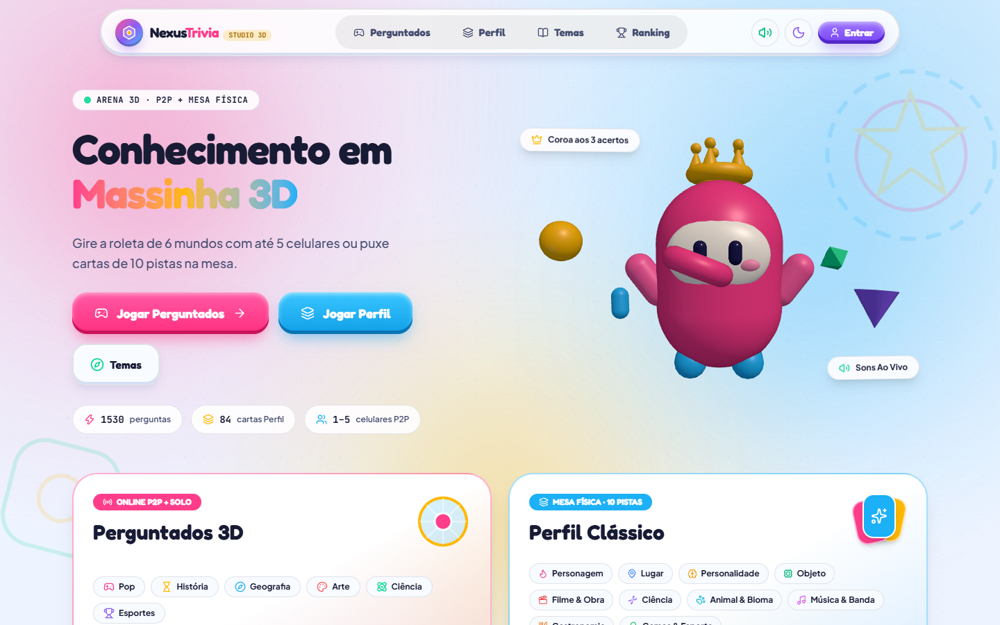
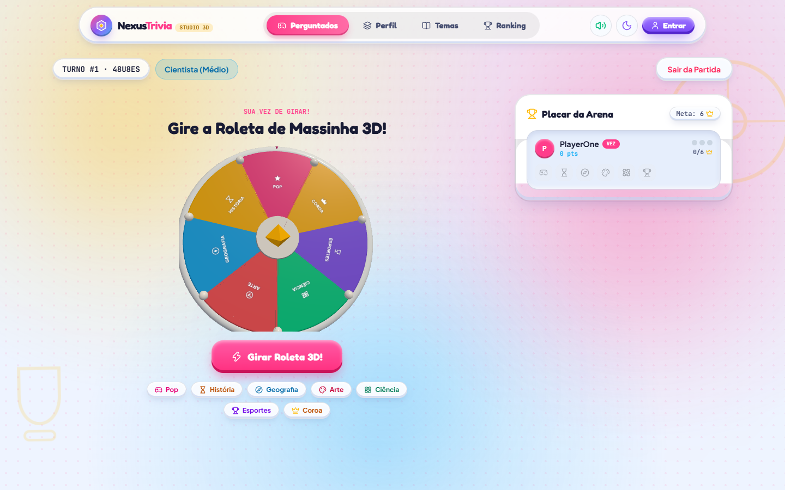
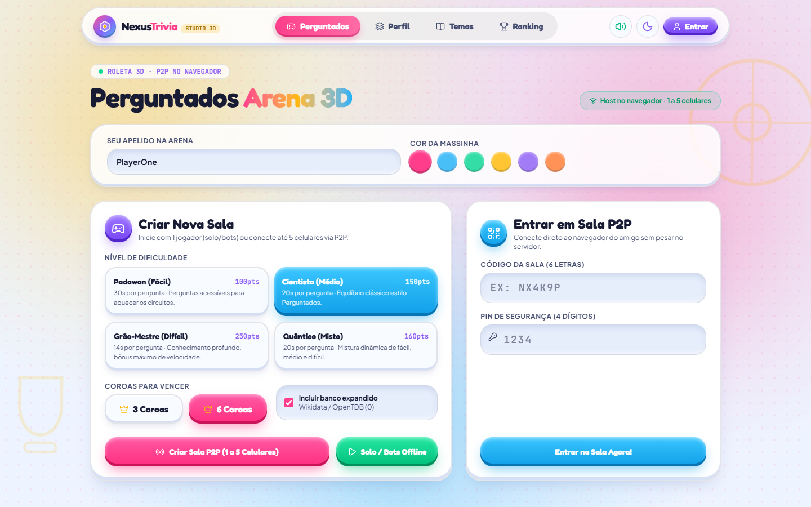
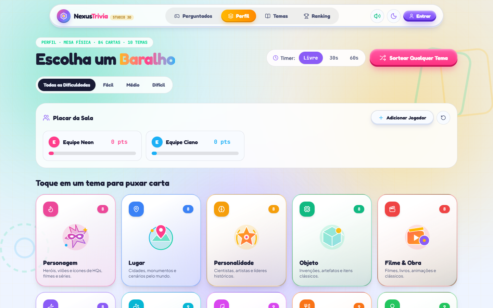
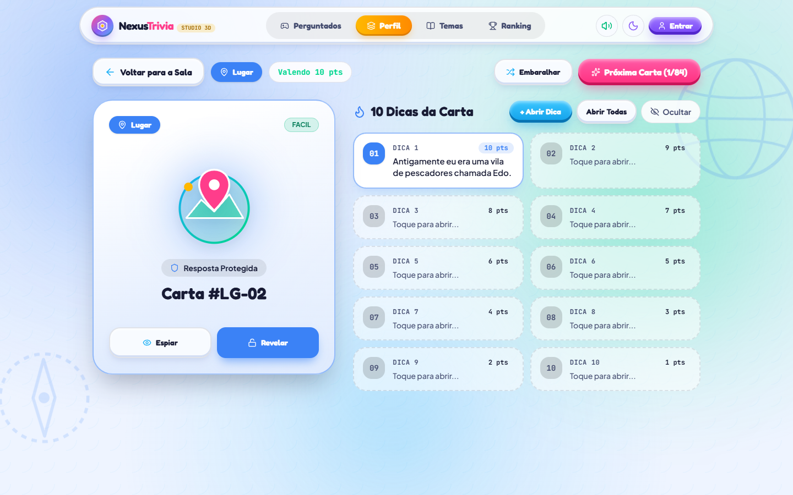
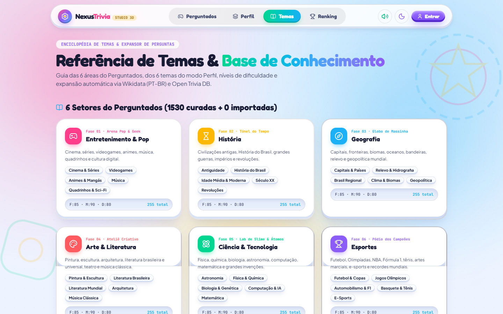
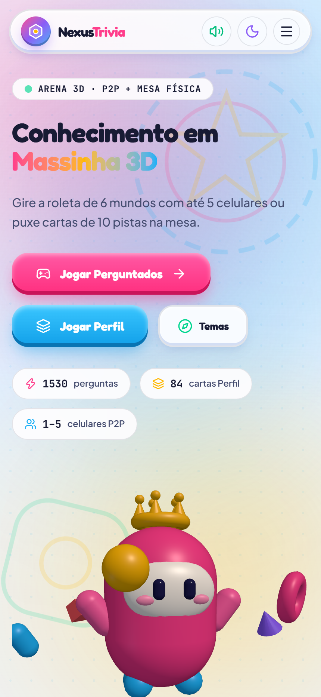

# NexusTrivia 3D

Aplicação web responsiva estilo **Perguntados 3D** + **Perfil** com estética **Arena Massinha 3D**, elementos interativos em Three.js, efeitos sonoros sintetizados via Web Audio API e multiplayer P2P direto no navegador para rodar leve no plano Free da Vercel.



## Modos de Jogo & Recursos

### 1. Perguntados Arena 3D (`/perguntados`)
- **Roleta de Massinha 3D em Three.js** com as **6 áreas do conhecimento** (*Entretenimento & Pop, História, Geografia, Arte & Literatura, Ciência & Tecnologia, Esportes*) + setor especial de **Coroa**.
- **Base Curada com 1.530 Perguntas Únicas em PT-BR** (255 por área), distribuídas em 3 níveis de dificuldade (**Padawan / Fácil, Cientista / Médio, Grão-Mestre / Difícil**) + modo **Quântico (Misto)**.
- **Multiplayer P2P direto no navegador (WebRTC / PeerJS)**: quem cria a sala atua como Host autoritativo localmente, conectando de **1 a 5 dispositivos** por código + PIN sem consumir compute contínuo do servidor Vercel.
- **Modo Solo / Bots Nerds**: jogue instantaneamente sozinho ou adicionando bots na arena local.

### 2. Perfil Clássico — Mesa Física (`/perfil`)
- **84 Cartas Curadas em 10 Temas** (*Personagem Fictício, Lugar, Pessoa Famosa, Objeto & Invenção, Obra & Mídia, Ciência & Conceito, Animal & Natureza, Música & Banda, Comida & Bebida, Jogo & Esporte*).
- **Fluxo Fiel à Mesa**: escolha um baralho, abra a carta em tela dedicada com **Escudo do Mediador ("Espiar")**, **10 dicas progressivas (10 a 1 pt)**, **Timer configurável (Livre / 30s / 60s)**, placar dinâmico por equipes e retorno rápido para a sala.

### 3. Enciclopédia & Expansor de Base (`/temas`), Ranking (`/ranking`) e Conta (`/conta`)
- **Expansão em tempo real** com importação de novas questões via **Wikidata SPARQL (PT-BR)** e **Open Trivia DB** persistidas no **Neon Postgres**.
- **Cadastro e Login** simples com e-mail e senha (sem 2FA), Prisma ORM + Neon Serverless Postgres com fallback automático para banco JSON local em desenvolvimento.

## Telas da Aplicação

| Roleta 3D — Perguntados Arena | Sala do Perguntados & P2P |
| --- | --- |
|  |  |

| Perfil Clássico — Seleção de Baralhos (10 Temas) | Carta em Foco (Escudo & 10 Dicas) |
| --- | --- |
|  |  |

| Enciclopédia de Temas & Expansor Wikidata | Mobile Responsivo |
| --- | --- |
|  |  |

## Arquitetura & Stack

- **Framework**: Next.js 16 (App Router) + React 19 + TypeScript + Tailwind CSS 4.
- **3D & Áudio**: Three.js (mascote e roleta 3D interativos) + Web Audio API (sintetizador próprio sem dependências externas).
- **Multiplayer**: WebRTC via PeerJS para salas P2P de até 5 celulares.
- **Banco de Dados**: Prisma ORM + Neon Serverless Postgres (`DATABASE_URL`) com fallback local em desenvolvimento.

## Rodando Localmente

```bash
npm install
npm run dev
```

Acesse `http://localhost:3000`. Sem `DATABASE_URL` configurada, cadastros e placares funcionam localmente em JSON (`data/local-db.json`).

### Scripts de Verificação

```bash
npx tsc --noEmit
npm run lint
npm run build
```

## Deploy na Vercel (Plano Free)

1. Importe o repositório na **Vercel**.
2. Em **Storage → Marketplace → Neon (Serverless Postgres)**, conecte um banco gratuito ao projeto (injeta `DATABASE_URL`).
3. Configure `AUTH_SECRET` nas variáveis de ambiente da Vercel.
4. Execute `npx prisma db push` apontando para o banco Neon e publique o deploy em produção.

## Engenharia Assistida por IA: Antes, Falhas e Correções

- **Antes (Baseline inicial):** Template padrão do `create-next-app` (`Next.js 16`, `React 19`, `Tailwind CSS 4`), sem engine de trivia, sem modo Perfil, sem multiplayer P2P e sem camada de persistência.
- **Falhas identificadas e correções aplicadas:**
  1. **Erro de escrita no filesystem somente leitura da Vercel sem `DATABASE_URL`:** em deploys iniciais sem Postgres provisionado, gravar `data/local-db.json` no diretório da aplicação falharia na Vercel. Corrigido em `src/lib/prisma.ts` e `src/lib/db.ts` validando `DATABASE_URL` / `POSTGRES_PRISMA_URL` / `POSTGRES_URL` e redirecionando o fallback JSON para `/tmp/nexus-trivia-local-db.json` quando `process.env.VERCEL` está ativo.
  2. **Exposição do gabarito no cliente P2P e esgotamento de perguntas:** na arquitetura PeerJS (`src/lib/p2p.ts` + `src/lib/game-engine.ts`), enviar a pergunta completa revelaria `correctIndex` no tráfego WebRTC. Corrigido com `sanitizeQuestionForClients()` antes do broadcast e com fallback progressivo em `pickQuestion()` (`src/data/questions/index.ts`) caso uma categoria/dificuldade seja esgotada.
  3. **Compatibilidade de build, TypeScript e Prisma na Vercel:** adicionado `postinstall: "prisma generate"` e `build: "prisma generate && next build"` em `package.json`, além da validação contínua com `npx tsc --noEmit` e `npm run lint` sem erros ou avisos.
